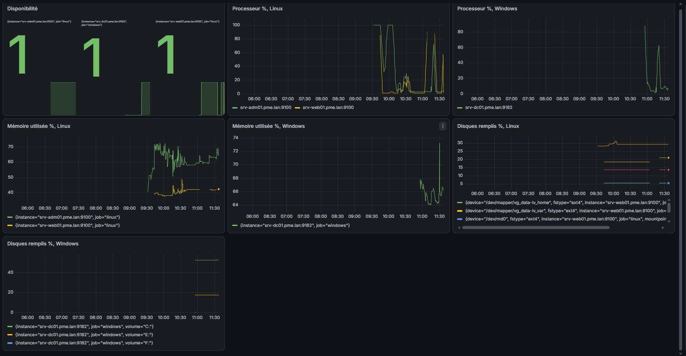
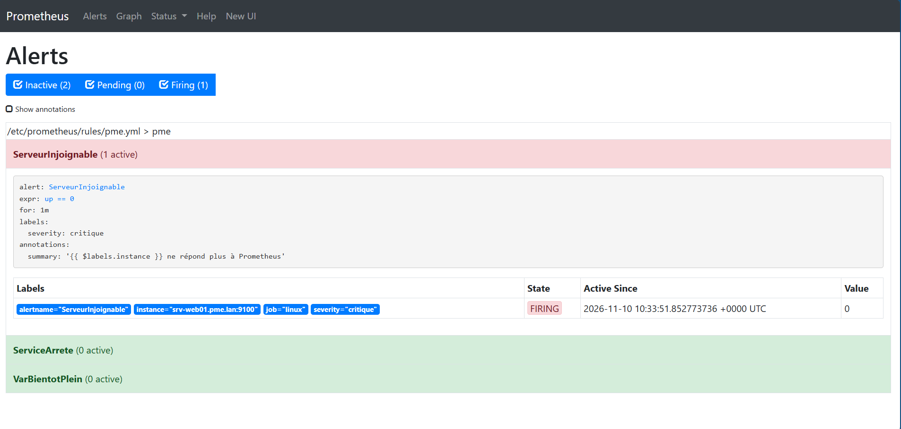

# Supervision du SI

## Principe
Chaque serveur expose ses métriques sur une page web (un **exporteur**). Prometheus, sur
SRV-ADM01, lit ces pages toutes les 15 secondes, garde l'historique et évalue des règles
d'alerte. Grafana dessine les tableaux de bord à partir de Prometheus.

## Composants
| Composant | Serveur | Port | Accès autorisé |
|---|---|---|---|
| node_exporter | SRV-WEB01, SRV-ADM01 | 9100 | 10.10.0.30 seulement (ufw) |
| windows_exporter | SRV-DC01 | 9182 | 10.10.0.30 seulement (pare-feu Windows) |
| Prometheus | SRV-ADM01 | 9090 | 10.10.0.0/24 |
| Grafana | SRV-ADM01 | 3000 | 10.10.0.0/24 |

Configuration : [`supervision/prometheus.yml`](../supervision/prometheus.yml) (cibles) et
[`supervision/pme.yml`](../supervision/pme.yml) (règles), copiés dans `/etc/prometheus/`.

## Cibles surveillées
| Job | Cible | État le 10/11 |
|---|---|---|
| prometheus | localhost:9090 | UP |
| linux | srv-adm01.pme.lan:9100 | UP |
| linux | srv-web01.pme.lan:9100 | UP |
| windows | srv-dc01.pme.lan:9182 | UP |

Vérification en ligne de commande, depuis SRV-ADM01 :
```bash
curl -s http://localhost:9090/api/v1/targets | grep -o '"health":"[a-z]*"'    # 4 × "up"
```

## Règles d'alerte
| Alerte | Expression | Délai (`for`) | Gravité | Ce qu'elle signale |
|---|---|---|---|---|
| ServeurInjoignable | `up == 0` | 1 min | critique | un serveur ou son exporteur ne répond plus |
| VarBientotPlein | espace libre de `/var` < 15 % | 10 min | avertissement | journaux ou cache apt qui remplissent `/var` |
| ServiceArrete | `node_systemd_unit_state{state="active"} == 0` | 1 min | critique | ssh, nginx ou smbd arrêté |

Le délai `for:` impose que la condition reste vraie pendant toute la durée avant de déclencher :
on n'est pas alerté pour un pic de deux secondes.

## Tableau de bord Grafana « Parc PME »
Source de données : Prometheus, `http://localhost:9090`.

| Panneau | Requête PromQL |
|---|---|
| Disponibilité | `up{job!="prometheus"}` |
| Processeur %, Linux | `100 - avg by (instance) (rate(node_cpu_seconds_total{mode="idle"}[5m])) * 100` |
| Processeur %, Windows | `100 - avg by (instance) (rate(windows_cpu_time_total{mode="idle"}[5m])) * 100` |
| Mémoire %, Linux | `(1 - node_memory_MemAvailable_bytes / node_memory_MemTotal_bytes) * 100` |
| Mémoire %, Windows | `(1 - windows_memory_physical_free_bytes / windows_memory_physical_total_bytes) * 100` |
| Disques %, Linux | `(1 - node_filesystem_avail_bytes{fstype=~"ext4\|xfs"} / node_filesystem_size_bytes{fstype=~"ext4\|xfs"}) * 100` |
| Disques %, Windows | `(1 - windows_logical_disk_free_bytes{volume=~"[A-Z]:"} / windows_logical_disk_size_bytes{volume=~"[A-Z]:"}) * 100` |



## Test de l'alerte ServeurInjoignable (10/11/2026)

**Condition provoquée** : arrêt de node_exporter sur SRV-WEB01, depuis SRV-ADM01.
```bash
cd ~/admin-si/ansible
ansible web -b -K -m service -a "name=prometheus-node-exporter state=stopped"
```

| Étape | Heure (Paris) | Ce qui se passe |
|---|---|---|
| Arrêt de l'exporteur | ~11:33:40 | Prometheus n'arrive plus à lire `srv-web01.pme.lan:9100` |
| **Pending** | 11:33:51 | `up` vaut 0 pour cette cible : la condition est vraie, le délai d'1 min commence |
| **Firing** | ~11:34:51 | la condition est restée vraie pendant 1 min : l'alerte se déclenche |
| Redémarrage de l'exporteur | ~11:36 [À COMPLÉTER : heure exacte] | `up` repasse à 1 |
| Alerte résolue | ~11:37 | Firing (0), toutes les règles en Inactive |



**Retour à la normale** :
```bash
ansible web -b -K -m service -a "name=prometheus-node-exporter state=started"
```

**Explication** : la métrique `up` est créée par Prometheus lui-même à chaque lecture d'une
cible (1 = lecture réussie, 0 = échec). Exporteur arrêté → connexion refusée → `up == 0`.
La règle passe en **Pending**, puis en **Firing** au bout de la minute du `for:`. Au
redémarrage, `up` repasse à 1 et l'alerte se résout seule, sans intervention.

**Remarque** : un premier essai, où l'exporteur n'était coupé que 7 secondes, n'avait pas
déclenché l'alerte. C'est le comportement voulu du `for: 1m` : une coupure brève ne réveille personne.

## Limite
Les alertes sont visibles dans l'interface de Prometheus, mais **aucune notification** n'est
envoyée (pas d'Alertmanager configuré). En production, Alertmanager enverrait un courriel ou
un message à l'astreinte.
